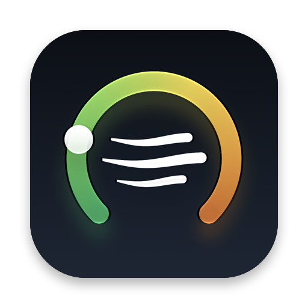
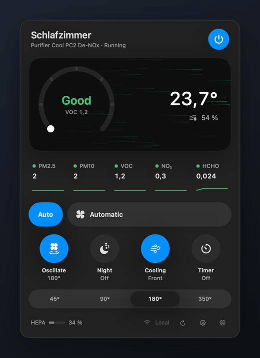
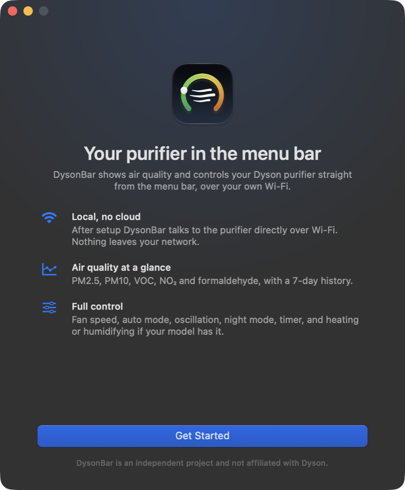
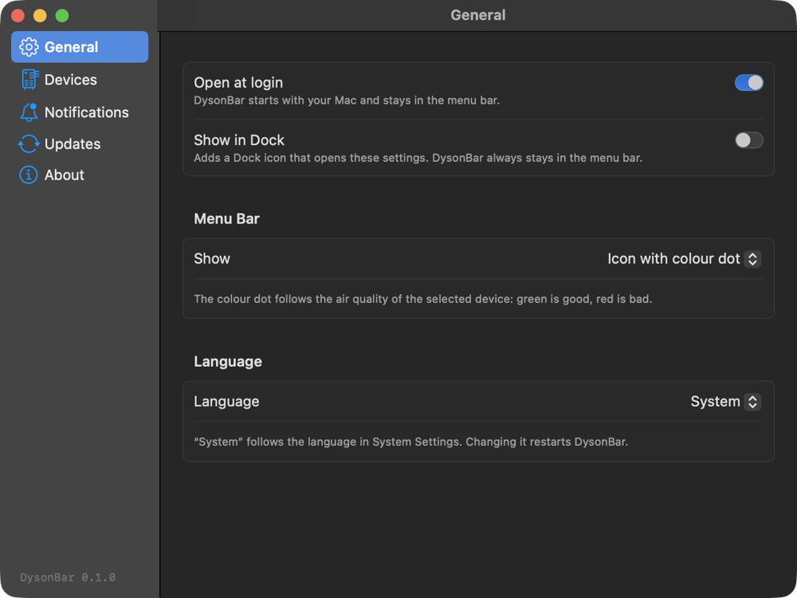
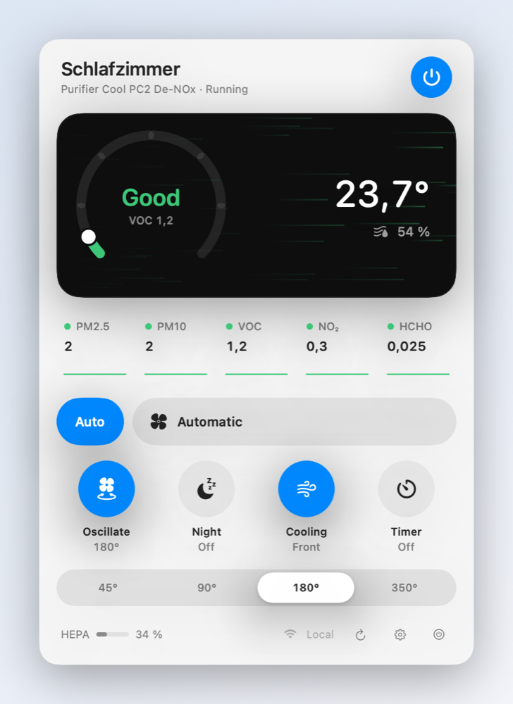

<div align="center">



# DysonBar

A native macOS menu bar app for Dyson air purifiers. Shows air quality and controls your purifier over your own Wi-Fi, without the Dyson cloud.

[](https://github.com/jx-grxf/DysonBar/releases/latest)


[Download](https://github.com/jx-grxf/DysonBar/releases/latest) · [Supported devices](#supported-devices) · [Security](SECURITY.md) · [Deutsch](#deutsch)



</div>

> [!TIP]
> Made for the moment you wonder whether the air in the room is fine and the MyDyson app is on a phone in another room. One click on the menu bar answers it.

## What it does

**Air quality**
- PM2.5, PM10, VOC, NO₂ and formaldehyde, rated on the same six bands as the MyDyson app and the device display.
- Temperature and humidity, refreshed every 30 seconds.
- Seven days of history per device, stored locally. Sparklines under each value, a 24-hour and 7-day chart one click away.
- The menu bar shows an icon, a colour dot for the current air quality, the rating as text, or the temperature.

**Control**
- Power, auto mode, fan speed 1–10, oscillation with 45°/90°/180°/350° range, night mode, airflow direction and sleep timer.
- Heating with target temperature on Hot+Cool models, humidifying with target humidity on Humidify+Cool models.
- Each control appears only if your model reports it, so untested models still get the right set.

**Around it**
- Notifications when the air stays bad for five minutes, a filter drops to 10 % or the device reports a fault code.
- Several purifiers on one account, with a switcher in the panel.
- English and German, switchable in Settings.
- Launch at login, optional Dock icon, Sparkle updates.

**Private by design**
- Signing in to MyDyson happens once, to fetch each purifier's local Wi-Fi key. The key goes into the macOS Keychain, the account password is never stored.
- After that DysonBar talks to the purifier directly over MQTT on your network. No Dyson cloud, no telemetry, no analytics.

## Screenshots

| Onboarding | Settings | Light mode |
|---|---|---|
|  |  |  |

## Install

**Homebrew**

```sh
brew tap jx-grxf/tap
brew trust --cask jx-grxf/tap/dysonbar
brew install --cask dysonbar
```

Homebrew only installs casks from third-party taps after `brew trust`.

**Manual**

1. Download `DysonBar-<version>.dmg` from [Releases](https://github.com/jx-grxf/DysonBar/releases/latest).
2. Drag DysonBar into Applications and open it.
3. Sign in with your MyDyson account in the window that appears. Dyson emails you a one-time code.
4. Allow access to the local network when macOS asks. Without it DysonBar can't reach the purifier.

Releases are signed with a Developer ID and notarized by Apple. DysonBar updates itself through Sparkle.

## Requirements

- macOS 15 Sequoia or newer. Liquid Glass controls on macOS 26 and later.
- A Dyson purifier connected to Wi-Fi and set up in the MyDyson app.
- The Mac on the same network as the purifier.

## Supported devices

DysonBar speaks the local MQTT protocol that Dyson's connected purifiers have used since 2018. It reads the capabilities from what the device reports, so the list below is a guide, not a whitelist.

| Family | Models | Tested |
|---|---|---|
| Purifier Cool | TP04, TP06, TP07, TP09, TP10, TP11 (PC1), TP12 (PC2 De-NOx) | TP12 |
| Pure Cool Desk | DP04 | – |
| Purifier Hot+Cool | HP04, HP06, HP07, HP09, HP10 | – |
| Purifier Humidify+Cool | PH01, PH02, PH03, PH04 | – |
| Purifier Big+Quiet | BP02, BP03, BP04 | – |

Not supported: the older Pure Cool Link family (TP02, HP02, DP01), which uses a different protocol, and robot vacuums or lights.

If your model works, or doesn't, please [open an issue](https://github.com/jx-grxf/DysonBar/issues/new) with the model number.

## Troubleshooting

- **"Not reachable"**: check that the purifier shows up in the MyDyson app and that the Mac is on the same Wi-Fi, not a guest network. In Settings → Devices you can enter the purifier's IP address from your router.
- **No values after signing in**: open System Settings → Privacy & Security → Local Network and allow DysonBar.
- **Sign-in fails**: pick the country your MyDyson account was created in. Accounts are regional.

## Development

```sh
./script/build_and_run.sh          # build dist/DysonBar.app and launch it
swift test                         # parser, protocol and history tests
./script/sync_strings.sh           # collect new UI strings into the String Catalog
```

`Sources/DysonKit` holds the MQTT client, the MyDyson sign-in, state parsing and history. `Sources/DysonBar` is the SwiftUI app. UI strings are English in code; German lives in `Sources/DysonBar/Resources/Localizable.xcstrings`.

Releases: `DYSONBAR_VERSION=x.y.z DYSONBAR_NOTARY_PROFILE=<profile> ./script/release.sh` builds a universal, notarized DMG and a signed Sparkle appcast.

## Credits

The protocol work of [libdyson](https://github.com/shenxn/libdyson) and [opendyson](https://github.com/libdyson-wg/opendyson) made this possible.

## License

[MIT](LICENSE) © Johannes Grof

DysonBar is an independent open-source project. It is not affiliated with, endorsed or sponsored by Dyson. Dyson is a trademark of Dyson Technology Limited.

---

## Deutsch

DysonBar ist eine Mac-App für die Menüleiste, die Dyson-Luftreiniger direkt über dein WLAN steuert. Sie zeigt Feinstaub (PM2.5, PM10), VOC, NO₂, Formaldehyd, Temperatur und Luftfeuchte, speichert sieben Tage Verlauf und steuert Lüfterstufe, Automatik, Schwenken, Nachtmodus, Timer sowie Heizen und Befeuchten bei den passenden Modellen.

**Installieren:** `brew tap jx-grxf/tap`, `brew trust --cask jx-grxf/tap/dysonbar`, `brew install --cask dysonbar` oder die DMG aus den [Releases](https://github.com/jx-grxf/DysonBar/releases/latest) laden. Beim ersten Start meldest du dich einmal mit deinem MyDyson-Konto an, danach läuft alles lokal ohne Dyson-Cloud. Die Sprache stellst du in den Einstellungen unter Allgemein um.

**Voraussetzungen:** macOS 15 oder neuer, ein Dyson-Luftreiniger im WLAN, Mac im selben Netz.
